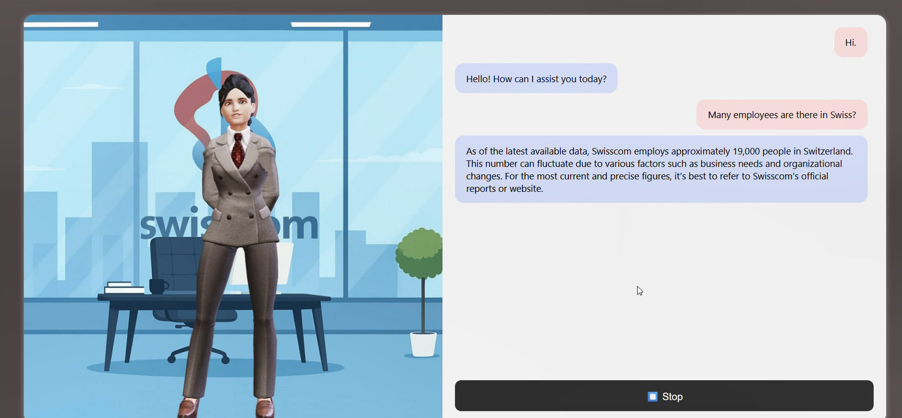
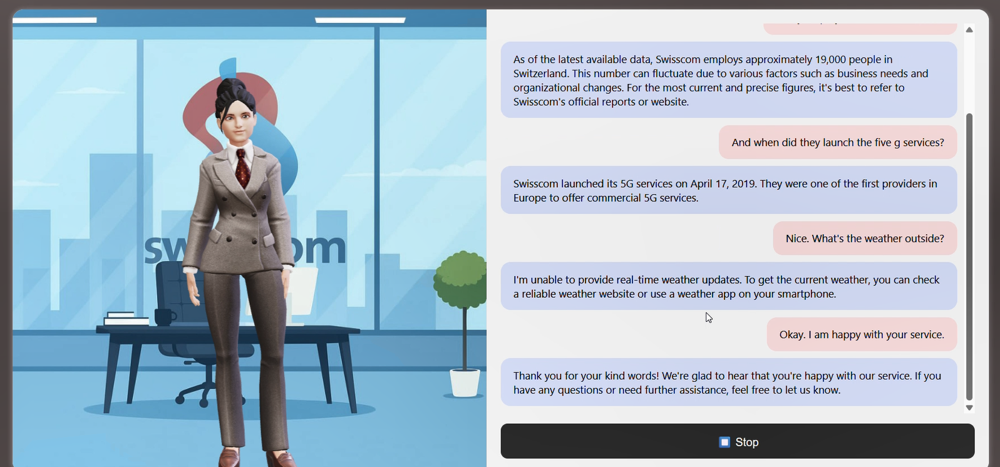
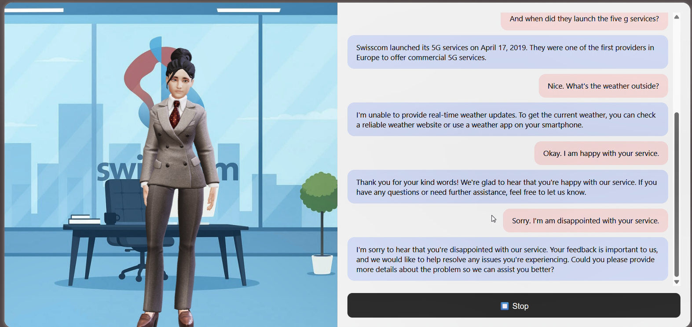
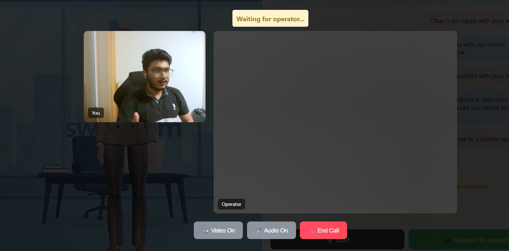

# RAG Customer-Service Chatbot (Swisscom × THD)

> Voice-enabled customer-service chatbot that answers questions from a 65-page document using Retrieval-Augmented Generation — built as a university project in collaboration with Swisscom.



## My role
Team of 10 students (THD module *AI Project*, 03.2025 – 07.2025). **I was responsible for speech synthesis** — turning the chatbot's text answers into spoken audio with Deepgram text-to-speech.

## Tech stack
Python · FastAPI · WebSocket · OpenAI API · RAG · FAISS · all-MiniLM-L6-v2 embeddings · Deepgram (speech-to-text & text-to-speech) · WebRTC · HTML5

## Results
- Knowledge base: **65-page** document
- Response latency reduced from **3–4 s to 1–2 s**

## How it works
1. The document is split into chunks, embedded with all-MiniLM-L6-v2 and stored in a FAISS index
2. The user speaks or types → Deepgram speech-to-text → the most relevant chunks are retrieved
3. An OpenAI LLM generates the answer from the retrieved context
4. The answer is spoken back via Deepgram text-to-speech; conversations can be escalated to a human agent over WebRTC

| Basic chat | Emotion: happy | Emotion: sad | Human hand-off (WebRTC) |
|---|---|---|---|
|  |  |  |  |

## Project structure
```
main.py            FastAPI app: HTTP + WebSocket endpoints, entry point
utilss.py          Speech-to-text, text-to-speech, LLM response generation
config.py          Settings (reads API keys from environment)
utils/             data_loader, embedder, retriever, prompt_helper (RAG pipeline)
vectorstore/       Prebuilt FAISS index
data/              Knowledge-base source files
static/, avatarrr/ Frontend pages and 3D avatar assets
operator.html      Human-agent console for WebRTC hand-off
```

## How to run
```bash
git clone https://github.com/jevintalaviya2004/Swisscom-AI-Chatbot.git
cd Swisscom-AI-Chatbot
pip install -r requirements.txt
# set OPENAI_API_KEY and DEEPGRAM_API_KEY in a .env file or your environment
python main.py        # serves on http://localhost:8000
```
